## À tester tout de suite

La plupart des projets ont une vidéo de présentation de 20 à 60 secondes, et plusieurs se testent en un clic.

### Dashboards Power BI

*Fichier prêt à l'emploi, données incluses, qui s'ouvre directement dans Power BI Desktop.*

<table>
<thead>
<tr>
<th align="left" width="24%">Projet</th>
<th align="left" width="44%">Ce que vous pouvez faire</th>
<th align="left" width="32%">Accès</th>
</tr>
</thead>
<tbody>
<tr>
<td valign="top"><a href="https://github.com/GomuGomuNo01/nyc-taxi-analyse-revenus"><b>NYC Taxi</b></a></td>
<td valign="top">Trouver où et quand placer les chauffeurs de taxi pour gagner le plus</td>
<td valign="top">&nbsp;</td>
</tr>
<tr>
<td valign="top"><a href="https://github.com/GomuGomuNo01/maven-toys-powerbi-analytics"><b>Maven Toys</b></a></td>
<td valign="top">Suivre les ventes, les marges et les stocks d'une enseigne de 50 magasins</td>
<td valign="top">&nbsp;</td>
</tr>
<tr>
<td valign="top"><a href="https://github.com/GomuGomuNo01/contoso-sales-powerbi"><b>Contoso Sales</b></a></td>
<td valign="top">Comprendre une baisse de chiffre d'affaires de 33 %</td>
<td valign="top">&nbsp;</td>
</tr>
<tr>
<td valign="top"><a href="https://github.com/GomuGomuNo01/Simple-Banking-System-Python"><b>SBS Bank</b></a></td>
<td valign="top">Explorer l'activité d'une néobanque et le comportement de ses clients</td>
<td valign="top">&nbsp;</td>
</tr>
</tbody>
</table>

### Applications en ligne

*À essayer directement dans le navigateur.*

<table>
<thead>
<tr>
<th align="left" width="24%">Projet</th>
<th align="left" width="44%">Ce que vous pouvez faire</th>
<th align="left" width="32%">Accès</th>
</tr>
</thead>
<tbody>
<tr>
<td valign="top"><a href="https://github.com/GomuGomuNo01/Chatbot-RAG"><b>Chatbot RAG · DocAssist</b></a></td>
<td valign="top">Poser une question à un document et obtenir une réponse sourcée en moins de 2 s</td>
<td valign="top">&nbsp;</td>
</tr>
<tr>
<td valign="top"><a href="https://github.com/GomuGomuNo01/sales-report-automation"><b>Sales Report</b></a></td>
<td valign="top">Transformer un fichier CSV en rapport PDF complet en 7 s</td>
<td valign="top">&nbsp;</td>
</tr>
<tr>
<td valign="top"><a href="https://github.com/GomuGomuNo01/automatisation-de-processus"><b>Automatisations</b></a></td>
<td valign="top">Voir six automatisations métier à l'œuvre</td>
<td valign="top">&nbsp;</td>
</tr>
<tr>
<td valign="top"><a href="https://github.com/GomuGomuNo01/Instagram-Unlike-Cleaner"><b>Instagram Unlike Cleaner</b></a></td>
<td valign="top">Essayer la vraie interface sur des données fictives, sans compte</td>
<td valign="top">&nbsp;&nbsp;</td>
</tr>
</tbody>
</table>

### Développement fullstack

*Présentation vidéo et documentation interactive.*

<table>
<thead>
<tr>
<th align="left" width="24%">Projet</th>
<th align="left" width="44%">Ce que vous pouvez faire</th>
<th align="left" width="32%">Accès</th>
</tr>
</thead>
<tbody>
<tr>
<td valign="top"><a href="https://github.com/GomuGomuNo01/hotel-management-system"><b>Hotel Management System</b></a></td>
<td valign="top">Parcourir le produit, du catalogue de chambres jusqu'au paiement</td>
<td valign="top"></td>
</tr>
<tr>
<td valign="top"><a href="https://github.com/GomuGomuNo01/mini_crm"><b>Mini-CRM</b></a></td>
<td valign="top">Voir comment le suivi des clients et des contrats fonctionne</td>
<td valign="top"></td>
</tr>
<tr>
<td valign="top"><a href="https://github.com/GomuGomuNo01/api-rest-jwt"><b>API REST JWT</b></a></td>
<td valign="top">Tester l'API et sa documentation interactive</td>
<td valign="top"></td>
</tr>
</tbody>
</table>

## Projets Data & IA

### [NYC Taxi : où positionner les chauffeurs ?](https://github.com/GomuGomuNo01/nyc-taxi-analyse-revenus)

Une compagnie de taxis veut savoir où et quand positionner ses chauffeurs pour maximiser leur revenu par heure. L'analyse de 7,7 millions de courses réelles à New York en 2019 identifie les zones et créneaux les plus rentables et débouche sur un dashboard Power BI validé par 26 tests automatisés.

`Python` `PySpark` `DuckDB` `Parquet` `Power BI` `DAX`

### [Maven Toys Analytics](https://github.com/GomuGomuNo01/maven-toys-powerbi-analytics)

Analyse de plus de 829 000 ventes d’une chaîne de 50 magasins pour identifier les causes de baisse de rentabilité. Mise en évidence de 29 069 $ de pertes mensuelles liées aux ruptures de stock et création d’un outil Power BI pour faciliter la prise de décision.

`Power BI` `DAX` `Power Query` `Python` `pandas`

### [Contoso Sales Analytics](https://github.com/GomuGomuNo01/contoso-sales-powerbi)

Le chiffre d’affaires d’une entreprise baisse de 33 %, passant de 43,8 M$ à 29,3 M$. L’analyse de 225 000 ventes permet d’identifier les produits et les clients les plus touchés. Un tableau de bord Power BI présente les résultats pour aider la direction commerciale à comprendre cette baisse et à prendre des décisions adaptées.

`Power BI` `DAX` `Power Query` `Python` `pandas`

### [SBS Bank](https://github.com/GomuGomuNo01/Simple-Banking-System-Python)

Une banque en ligne souhaite vérifier si ses partenaires lui apportent des clients actifs. L’analyse de 254 000 opérations sur 18 mois révèle que ces clients utilisent leur compte deux fois moins souvent que les autres. Ces résultats permettent de proposer six actions prioritaires pour améliorer leur activité.

`Python` `MySQL` `pandas` `SciPy` `Power BI` `DAX`

### [Telco Churn Prediction](https://github.com/GomuGomuNo01/telco-churn-prediction)

Un opérateur télécom perd des clients chaque mois sans savoir lesquels cibler en priorité. Après comparaison de neuf modèles sur 7 043 clients, le modèle retenu détecte 73 % des résiliations réelles et aide l'entreprise à concentrer ses actions de fidélisation sur les profils les plus à risque.

`Python` `scikit-learn` `XGBoost` `statsmodels` `Streamlit`

### [Chatbot RAG · DocAssist](https://github.com/GomuGomuNo01/Chatbot-RAG)

Un assistant IA qui transforme les documents internes en réponses rapides et vérifiables. Il retrouve les informations pertinentes, cite ses sources et signale lorsqu’une réponse est absente. Objectif : gagner du temps tout en renforçant la fiabilité des réponses.

`Python` `LangChain` `FAISS` `API Claude` `FastAPI` `Docker`

### [Career-Ops](https://github.com/GomuGomuNo01/career-ops)

Candidater à plusieurs offres devient rapidement difficile lorsque les informations sont dispersées entre les annonces, les CV et les tableaux de suivi. Career-Ops centralise les dossiers de candidature, analyse les offres et met à jour automatiquement leur statut grâce à des agents IA et à des outils connectés.

`Claude Code` `MCP` `Python` `Go`

### [Sales Report Automation](https://github.com/GomuGomuNo01/sales-report-automation)

Fini les heures de préparation manuelle : ce pipeline transforme un CSV en rapport PDF complet en 7 secondes, calcule automatiquement les KPI et sécurise le résultat grâce à 50+ tests automatisés.

`Python` `pandas` `Matplotlib` `fpdf2` `Streamlit` `pytest`

### [Automatisation de Processus](https://github.com/GomuGomuNo01/automatisation-de-processus)

Six tâches répétitives, comme le suivi des stocks, l’envoi d’e-mails et la collecte de données en ligne, sont automatisées grâce à des scripts Python. Testés avant chaque mise en service, ces outils fonctionnent de manière fiable depuis deux ans et permettent de gagner du temps au quotidien.

`Python` `Selenium` `pandas` `openpyxl` `Streamlit`

## Projets Développement Fullstack

### [Instagram Unlike Cleaner](https://github.com/GomuGomuNo01/Instagram-Unlike-Cleaner)

Effacer à la main des années de « J'aime » Instagram prend des heures, et confier son mot de passe à un service tiers est risqué. Cet outil 100 % local filtre les likes, fait valider chacun d'eux avant suppression et les retire par lots, sans jamais voir le mot de passe : 1 493 likes recensés en 14 minutes sur un compte réel, avec 313 tests automatisés.

`Python` `FastAPI` `React` `TypeScript` `Playwright`

### [Hotel Management System](https://github.com/GomuGomuNo01/hotel-management-system)

Un hôtel doit gérer les réservations, les paiements, les arrivées, les départs et les réclamations sans créer de conflits entre les informations. Cette application centralise le cycle de vie des séjours, tandis que les mises à jour sont immédiatement visibles grâce à la communication en temps réel entre le serveur et l'interface.

`Laravel` `React` `MySQL` `WebSocket`

### [API REST JWT · Spring Boot](https://github.com/GomuGomuNo01/api-rest-jwt)

Une application métier doit protéger ses données sans devenir difficile à maintenir. Cette API authentifie chaque utilisateur, applique des droits selon son rôle et fournit une documentation claire pour faciliter son intégration et son évolution.

`Java` `Spring Boot` `Spring Security` `JUnit` `Swagger`

### [Mini-CRM](https://github.com/GomuGomuNo01/mini_crm)

Les informations clients et contrats sont souvent dispersées entre des tableurs et des e-mails. Cette application centralise leur suivi, restitue les indicateurs clés dans un tableau de bord et conserve les données dans une base structurée pour faciliter le pilotage commercial.

`C#` `ASP.NET Core 8` `EF Core` `MySQL`

### [Hospital](https://github.com/GomuGomuNo01/Hospital)

Les données de santé exigent un accès strictement contrôlé et une traçabilité complète. Ce système sépare les droits entre administrateur, médecin et infirmier, impose une authentification à deux facteurs et enregistre chaque action dans un journal d'audit pour renforcer la sécurité.

`Laravel` `PHP` `Blade` `MySQL`

## Stack technique

**Data & Analyse**

SQL avancé (CTE, fonctions de fenêtrage, vues analytiques) · DAX, Power Query et modélisation en étoile · statistiques appliquées (test du khi-deux, segmentation RFM, VIF) · nettoyage, structuration et contrôle qualité de données

**IA Générative & Agents**

RAG avec recherche hybride, API Claude (Anthropic), prompt engineering, serveurs MCP connectés à des outils maison, utilisation quotidienne de Claude Code

**Développement Fullstack**

API REST sécurisées (JWT), temps réel (WebSocket), architecture en couches, tests automatisés (pytest, JUnit, xUnit)

**Automatisation & Tests**

Collecte de données web, envoi d'e-mails SMTP, orchestration TEST / PRODUCTION, intégration continue

**Bases de données**

**Outils & Déploiement**

Déploiement sur Render, Hugging Face Spaces, Streamlit Community Cloud et GitHub Pages

## Certifications

| Certificat | Organisme | Date |
|---|---|---|
| [AWS SimuLearn : Les fondamentaux du cloud](certificates/AWS_SimuLearn_Les_fondamentaux_du_cloud.pdf) | AWS Training & Certification | Septembre 2026 |
| [AWS SimuLearn : Premiers pas dans le cloud](certificates/AWS_SimuLearn_Premiers_pas_dans_le_cloud.pdf) | AWS Training & Certification | Septembre 2026 |

## Activité

<a href="https://cedric-kouadio-portfolio.onrender.com/">
<picture>
  <source media="(prefers-color-scheme: dark)" srcset="https://raw.githubusercontent.com/GomuGomuNo01/GomuGomuNo01/output/activity-card-dark.svg">
  <source media="(prefers-color-scheme: light)" srcset="https://raw.githubusercontent.com/GomuGomuNo01/GomuGomuNo01/output/activity-card-light.svg">
  
</picture>
</a>

